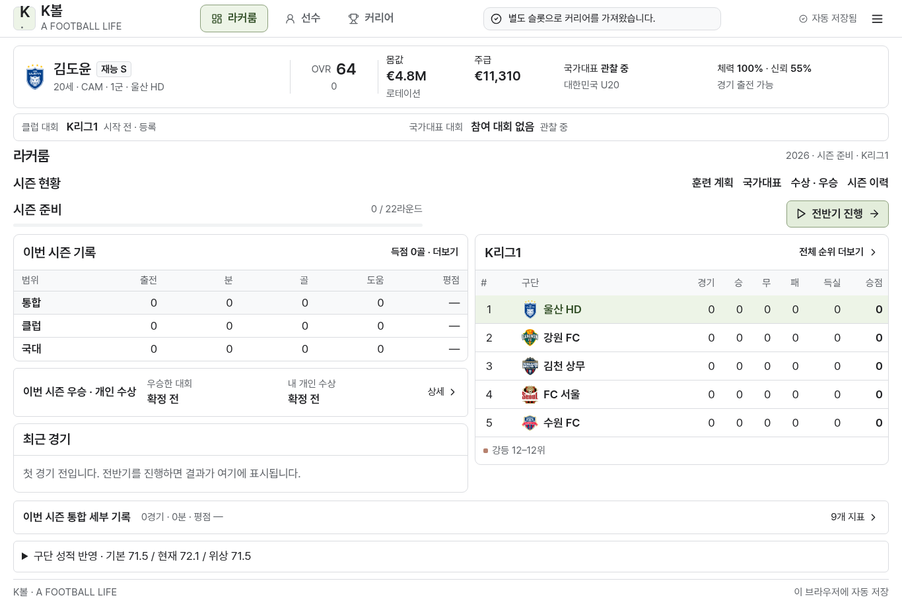

# K볼 2.5 · 간결한 동선과 상세한 커리어의 연결

훈련·국대·수상·시즌 이력으로 들어가려면 주 화면과 하위 화면을 차례로 선택해야 했고, 라커룸에는 빈 수상 카드와 세부 지표가 길게 이어졌습니다. 홈에서 필요한 화면으로 바로 이동하고, 우승 대회·개인상 이름은 바로 읽고, 상세 지표는 펼쳐 볼 수 있도록 정리했습니다. 경기·성장·이적·주장·치트·저장·은퇴 기록의 기능과 원천 데이터는 유지합니다.

## 확인한 자료와 확인하지 못한 범위

현재 K볼의 `src/App.tsx`, `src/components/`, `src/game/`에서 화면, 저장 계약, 경기 원장과 성장·세계·국대·스카우팅·수상 계산을 확인했습니다. 보존된 `legacy.html`과 `v56-career-balance.js`의 요약 카드·단계별 진행·훈련·이적 화면 및 계산도 읽었습니다. 구버전의 시즌 합산 결과를 현재 K볼의 실제 경기 원장에 덮어쓰지 않았습니다.

요청서의 `https://football-career-astra12.kangjh3.chatgpt.site/web/`는 이 환경에서 `Tunnel connection failed: 403 Forbidden`으로 차단됐습니다. 해당 사이트의 별도 원본 소스도 작업공간에서 찾지 못했습니다. 저장소의 CAREER24가 그 사이트와 같다는 근거는 없으며, 실제 사이트 화면을 확인하거나 그 소스를 통합했다고 주장하지 않습니다. 이번 UI는 요청서에 명시된 간결함·즉시 읽기·짧은 동선 원칙을 확인 가능한 K볼에 적용한 결과입니다. 해당 사이트와의 직접 대조는 남아 있습니다.

## 바뀐 화면과 유지한 깊이

| 위치 | 변경 | 유지한 내용 |
|---|---|---|
| 상단 선수 요약 | 재능 등급을 이름 옆에 표시 | 나이·포지션·소속·종합 능력과 변화·몸값·주급·국대·체력·신뢰 |
| 라커룸 빠른 이동 | 훈련 계획·국대·수상·시즌 이력을 한 번 눌러 기존 화면에서 열기 | 기존 3개 주 메뉴와 세부 화면, 별도 계산·복제된 편집창 없음 |
| 시즌 수상 | 시즌 기록 바로 아래에 우승 대회와 개인상 이름을 항상 표시, 한 번 누르면 출전·메달·수상 설명 펼치기 | 실제 확정 우승과 개인상, 종료 전 1위와 우승의 구별, 과거 시즌별 조회 |
| 시즌 상세 | 하단 한 줄에 출전·시간·평점, 펼치면 기존 9개 지표와 대회별·경기별 전체 기록으로 이동 | 성공/시도·성공률·90분당·옛 지표의 미보존 표시 |
| 개인 순위 | 창 상단에 내 이름·순위·실제 기록 고정, 골키퍼의 홈 요약은 무실점 순위 | 득점·도움·무실점 전체 명단과 실제 리그 원장·동률 규칙 |
| 순위·계약·훈련 | 기존 방식을 유지하고 새 동선에서 검증 | 주변 5팀·전체 순위 더보기·승무패, 시즌 종료 계약, 연간 훈련과 현재 수치 |

미확정 오프시즌 훈련은 기존의 `훈련 선택`을 사용하고 같은 바로가기를 추가하지 않습니다. 계약·훈련이 확정되기 전에는 다음 시즌 버튼이 열리지 않습니다. 첫 경기 전의 큰 빈 카드는 한 줄 안내로 줄였습니다. 같은 선수 화면에서 훈련 탭을 본 뒤 설정의 능력치 편집을 열어도 능력치 탭으로 바로 전환되도록 고쳤습니다. 화이트·회색 바탕과 제한된 연두 포인트, 주요 글자 크기를 유지합니다.

## 같은 기록으로 이어지는 화면

`season-overview.ts`는 실제 저장을 읽기만 하는 투영입니다. 홈·기록 화면·통산 국대 집계가 같은 국대 경기 목록을 사용합니다. 현재 기록과 대회 보관 기록에 같은 `fixtureId`가 있으면 한 번만 셉니다. 같은 시즌의 클럽·국대 합계를 만들고 세부 지표가 있는 경기만 성공률 분모에 사용합니다. 지난 시즌의 국대 경기를 현재 시즌에 섞지 않습니다.

통합 경기 목록은 서로 다른 대회의 라운드 번호 대신 실제 날짜를 먼저 비교합니다. 날짜가 없는 옛 경기는 날짜를 만들지 않고 시즌·기존 라운드 순으로 남깁니다. 시즌 종료 후 새 구단에 계약해도 방금 마친 순위표의 내 팀은 그 시즌 구단으로 표시합니다. 접기·펼치기·이동만으로 저장과 세계를 수정하지 않습니다.

## 요청서의 계산 항목

| 요청 | 이번 처리와 확인 경로 |
|---|---|
| 개인 활약 → 경기 → 승점·순위 | 기존 실제 행동·득점 원장을 유지. `match-engine.test.ts`의 같은 시드 전체 일정·약팀 다득점·패스/수비 기여·스코어 정합성 반복 검사 |
| 동적 구단 전력 | 기존 기본 전력 보존·완만한 성과 반영을 유지. `club-development.test.ts`, `roster-calibration.test.ts`, `world.test.ts`에서 실제 재투자·이적 직후 기여 이동·자료 보정 확인 |
| 재능·성장 | 2.4의 재능별 잠재력·전성기·노화 기준을 유지. `growth.test.ts`의 15→28세 여러 시드·재능·벤치·포지션 비교와 실제 시즌 전환 검사 |
| 이적 현실성 | 최근 3시즌·잠재력·성장·포지션 수요·예산을 보는 기존 로직 유지. `scouting.test.ts`의 K2 25골 유망주/부진 비교와 예산·실력 제한 확인 |
| 대회·국대 | 구현된 리그·국대 일정·예선·탈락·실제 결승을 유지. `national.test.ts`와 `integration.test.ts`의 국가별 반복 대회·일정·소집·중복 경기 방지 확인 |
| 순위·수상 | 리그 전용 원장과 수상 규칙 유지. `league-leaders.test.ts`, `tournament-awards.test.ts`, `honours.test.ts`, `career-systems.test.ts` 및 실제 브라우저 표시 확인 |
| 은퇴 TXT·저장 | 2.4의 한국어 전체 TXT와 JSON 보존. `career-text.test.ts`, `storage.test.ts`와 실제 30시즌 가져오기·재접속·다운로드 검사 |

국내 컵·클럽 대륙대회는 현재 구현돼 있지 않으며 이번에 추가하지 않았습니다. 앞서 합의한 기존 대회 정상화 범위를 유지합니다. 참가하지 않은 대회의 일정·참가권·트로피를 생성하지 않습니다. 게임 규칙과 실제 규정의 차이는 기존 [규칙 안내](RULES.md)를 유지합니다.

## 실행한 검증

- 타입 검사·제작 빌드·단일 HTML/ZIP 생성 성공. 자동 검사 **177개 통과, 실패 0개**, 30시즌 신규 생성 1개는 생략했습니다.
- 제작 빌드와 배포용 HTML에서 일반 플레이·PC/모바일·전체 순위·계약·훈련·저장/복원·손상 해시 거부·다음 시즌·은퇴·TXT·치트 흐름을 각각 11개 시나리오로 확인했습니다. 배포 HTML은 외부 자산 요청이 없었습니다.
- 별도 홈 검사 4개 시나리오 통과. 1366×768·1920×1080·390×844에서 핵심 정보와 바로가기, 훈련의 실제 수치, 펼친 9개 지표, 기록 화면과의 합계, 종료 시즌 우승 이름과 득점/도움 표시를 확인했습니다. 보기·이동 전후 저장 지문도 같았습니다. 마지막 동일 화면의 치트 편집 동선 수정 후 홈 4개 시나리오를 제작 빌드·단일 HTML 양쪽에서 다시 확인했습니다.
- 대비 검사 **124개 화면·13,732개 텍스트 표본**, 대비 실패 0·고정 요소 겹침 0·잘린 글자 0·페이지 실행 오류 0. 측정한 최소 대비는 4.752:1이었습니다. 비활성 글자 337개도 포함합니다. 표 내부의 의도된 스크롤과 모바일 마지막 열 접근도 확인했습니다.
- 기존 실제 30시즌·81,104,879바이트 저장을 브라우저로 가져와 재접속한 뒤 TXT 하나를 받았습니다. 클럽 1,020경기·국대 108경기의 주요 지표 합계와 모든 시즌·수상을 대조했습니다. TXT 14,084,757바이트는 이전 2.4 엔진으로 같은 저장에서 생성한 파일과 바이트 단위로 같고 원시 JSON 부록도 없었습니다.
- 위 검사는 30시즌 전체를 새로 시뮬레이션한 검사가 아닙니다. 실제 보존된 장기 저장을 사용한 호환·내보내기 검사는 별도로 다시 실행했습니다.

이번 반복 실험의 실제 결과는 다음과 같습니다. 약팀의 8개 38경기 시즌에서 낮은 능력 조건은 2~8골·평균 승점 26.75·평균 18.375위, 높은 능력 조건은 32~43골·48.375점·12위였습니다. 같은 40개 시드의 8팀 전체 일정 비교에서는 우승 1/40→16/40이며 우승이 보장되지 않았습니다. 조건에 골 수를 직접 넣거나 사후 순위를 올린 검사가 아닙니다. 같은 종합 능력 92인 스타를 둔 64회 축약 월드컵에서 프랑스 우승 16회, 베트남 0회로 대표팀 전체 전력을 구별했습니다.

15→28세 고정 출전·훈련 조건 6개 시드에서 S는 90·90·90·90·91·92, SSS는 95·96·96·97·96·96이었습니다. 벤치·휴식 S는 46이었습니다. 이는 실제 모든 커리어를 보장하는 수치가 아니라 통제 조건의 성장 비교입니다.

재현 명령:

```sh
KBALL_SKIP_LONG_TEST=1 npm test
npm run build
npm run build:playable
PLAYWRIGHT_CHROMIUM_EXECUTABLE=/usr/bin/chromium npm run test:e2e
PLAYWRIGHT_CHROMIUM_EXECUTABLE=/usr/bin/chromium npm run test:home
PLAYWRIGHT_CHROMIUM_EXECUTABLE=/usr/bin/chromium npm run test:colors
# 동일 검사에 KBALL_TEST_URL=http://127.0.0.1:4180/Kball.html을 지정하면 배포 HTML 사용
# 기존 실제 30시즌 저장이 있을 때:
npm run test:long-txt
```

홈 검사와 대비 검사는 E2E가 만든 `test-results/career-baseline.json`과 `career-completed.json`을 사용합니다. 별도 경로는 `KBALL_UI_FIXTURES_DIR`, `KBALL_COLOR_BASELINE`, `KBALL_COLOR_COMPLETED`로 지정할 수 있습니다. 30시즌 검사는 `KBALL_LONG_SAVE`로 입력을 지정합니다. 모든 대회의 미래 결과나 실제 축구의 우승 분포를 보장하는 검사는 아닙니다.


## 수정 파일

- `src/App.tsx`, `src/components/PlayerStrip.tsx`, `PlayerPanel.tsx`, `CareerPanel.tsx`: 선수 요약과 기존 세부 화면으로의 직접 이동.
- `src/components/LockerRoom.tsx`, `LockerRoom.css`, `SeasonHonours.tsx`, `LeagueLeaders.tsx`: 핵심 정보 배치·펼침·내 개인 순위 표시.
- `src/game/season-overview.ts`, `src/components/Shared.tsx`: 같은 국대 원장·시즌 합계와 날짜 정렬. `src/game/season-overview.test.ts`에 혼합 구기록·중복 경기·시간순·보기의 불변성 검사.
- `src/game/engine.ts`, `package.json`, `package-lock.json`: 2.5.0 버전과 홈 검사 명령. 경기·성장·구단·이적·국대 계산식은 이번에 변경하지 않았습니다.
- `tests/kball-home-integration.test.mjs`, `kball-browser.test.mjs`, `kball-color-audit.mjs`: 새 동선·접힘 UI·대용량 가져오기 검사.
- `scripts/build-playable.mjs`, `README.md`, 이 보고서와 아래 실제 화면: 단일 배포 파일 안내·변경과 검증 근거.

## 실제 화면



[모바일 종료 시즌·우승 상세 화면](screenshots/kball-2.5-mobile.png)
