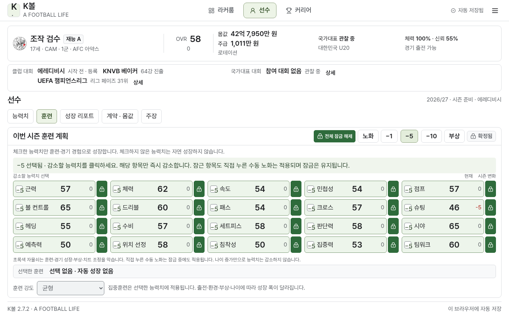
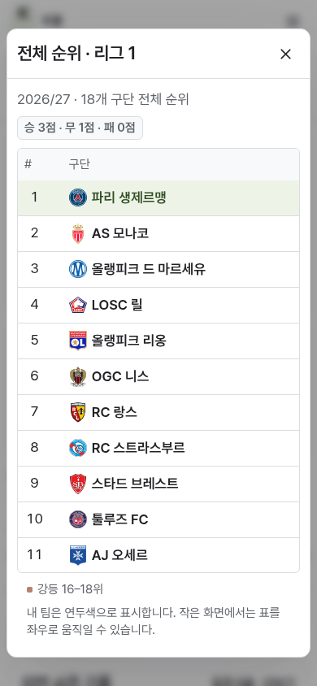
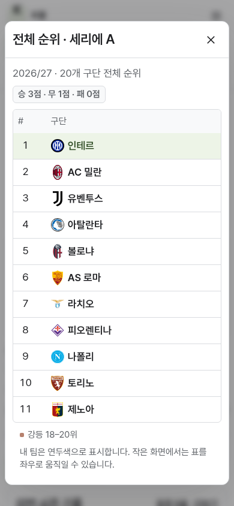

# K볼 2.7.2 · 훈련·잠금·로고 여섯 항목

1. **체크한 능력치만 자동 성장합니다.** 훈련, 리그·컵·국가대표 경기 경험, 유소년 정신 능력 발달을 중앙 변경 함수에서 모두 제한합니다. 체크하지 않은 항목에는 자동 성장치를 적용하거나 쌓아 두지 않습니다. 기존 수치·이전 성장 원장은 보존하고 업데이트 후 진행부터 적용합니다. 선택한 항목의 성장식·재능 잠재력은 유지하므로, 여러 능력치를 키우려면 시즌마다 훈련 대상을 바꿔야 합니다. 부상에 따른 감소는 성장과 별도이고 기존 잠금도 적용됩니다.

2. **잠긴 버튼은 초록색입니다.** 개별 자물쇠는 진한 초록 배경·흰 아이콘으로, 잠긴 능력치 행은 연한 초록 배경과 짙은 글씨로 표시합니다. 체크 여부와 자물쇠 상태는 별도로 보입니다. 잠금은 훈련·경기 성장·부상 감소·치트 증가를 막습니다.

3. **훈련 0개로 진행할 수 있습니다.** 선수 생성과 오프시즌 계획 확정 모두 0개 선택을 허용합니다. 계약·잔류 결정 후에는 훈련 화면을 열거나 확정하지 않고 다음 시즌을 시작할 수도 있습니다. 이때 이전 시즌의 선택을 몰래 이어 쓰지 않고 빈 계획으로 시작하며 능력치가 자동 성장하지 않습니다. 다음 시즌 계획이 없는 이전 저장도 동일하게 처리합니다. 계약 선택은 기존 방식대로 필요합니다.

4. **모바일에서 실제 엠블럼을 숨기지 않습니다.** 기존 스타일에 작은 화면에서 `.table-club .team-badge`와 경기 행의 로고를 `display:none`으로 만드는 규칙이 있었습니다. 순위표·경기 목록에 로고 공간을 유지하도록 고쳤습니다. PSG·인테르 및 프랑스·이탈리아·네덜란드 구단들의 실제 이미지가 데스크톱·390px 화면·오프라인 다운로드판에서 보이는지 확인합니다. 웹 버전도 방문하지 않은 구단의 로고까지 미리 캐시하며 이미지 내용이 바뀌면 캐시 버전을 바꿉니다. 현재 보유 로고는 **913개 국내 명단 중 784개**입니다. 미확보 129개와 별도 국제 초청 87개는 여전히 중립 아이콘이며, 새로 확보했다고 표시하지 않습니다. 파일 하단에 `K볼 2.7.2`를 표시해 실행 버전을 확인할 수 있습니다.

5. **전체 잠금은 토글입니다.** 훈련 상단의 ‘전체 잠금’을 누르면 필드 선수 20개 또는 GK 10개를 한 명령으로 잠급니다. 일부만 잠겼을 때도 누르면 전체 잠금이 됩니다. 다시 ‘전체 잠금 해제’를 누르면 전부 해제합니다. 개별·전체 상태는 저장과 재실행 후에도 유지합니다.

6. **직접 누른 수동 노화는 잠금을 무시합니다.** 잠긴 항목에도 −1/−5/−10을 적용할 수 있습니다. 누른 항목 하나만 줄이고 0에서 멈추며 OVR·몸값·성장 원장·수동 노화 이력을 갱신합니다. 자물쇠 자체는 계속 켜져 있고 자동 성장이나 밀린 성장의 복원은 없습니다. 기존 일괄 노화 기록은 보존합니다.

## 검증과 재현

- 로직 테스트: 전체 204개 중 **203개 통과**, 기존 30시즌 생성 테스트 1개 생략. 이후 이전 저장의 훈련 계획 누락·legacy 경로를 추가 점검하는 훈련 제어 테스트 6개도 통과했습니다.
- 웹 브라우저 통합: 실제 시즌·이적·다음 시즌·JSON·백업·은퇴 TXT·모바일 GK·치트 11개 항목 통과.
- 훈련 제어 UI: 훈련 0개 생성, 초록 잠금, 원자적 전체 토글, 잠금 중 노화, 데스크톱·모바일·재실행, 빈 계획 확정/직접 다음 시즌의 두 경로를 웹·다운로드판에서 검사합니다. 이전 버전의 실제 완료 저장을 가져와 과거 기록과 능력치 보존도 대조합니다.
- 로고: 784개 실제 SVG 디코딩, HTML 내 포함, 네덜란드 18팀 전체 순위, PSG·인테르와 각 리그의 작은 구단들까지 모바일의 이미지 크기가 0이 아닌지 검사합니다. 다운로드판은 네트워크를 끊고 같은 검사를 수행합니다.
- 웹 오프라인: 로고를 표시하지 않은 새 시작 화면에서 서비스 워커 설치를 마치고 784개 캐시를 확인한 뒤 인터넷을 끊습니다. 재실행과 모든 이미지 디코딩을 확인합니다.
- 색상: 142개 화면·15,095개 글자 샘플, 대비 실패·글자 잘림·고정 요소 겹침·페이지 오류 0개. 가장 낮은 측정 대비는 4.76입니다. 잠금 버튼은 `#2e6b3b` 배경에 흰 아이콘, 잠긴 행은 `#edf5eb` 배경에 `#202124` 글씨를 사용합니다.

`npm run build`, `npm run build:playable`, `KBALL_SKIP_LONG_TEST=1 npm test`로 빌드·로직을 검사합니다. 미리보기 서버를 실행한 뒤 `npm run test:e2e`로 저장 검증 자료를 만들고 `npm run test:training-controls`, `npm run test:crests`, `npm run test:offline-crests`를 실행할 수 있습니다. 이전 저장 경로는 `KBALL_CONTROLS_FIXTURE`, 테스트 주소와 결과 폴더는 `KBALL_TEST_URL`·`KBALL_TEST_RESULTS_DIR`로 지정합니다. 관리형 브라우저의 로컬 파일 URL 차단 때문에 다운로드 HTML은 로컬 HTTP 서버에서 제공해 검사하며, 파일 URL 실행을 검증했다고 표시하지 않습니다.

실제 결과와 배포 파일 검증은 [2.7.2 검증 보고서](validation/kball-2.7.2.json)에 기록합니다.

[검증한 2.7.2 ZIP 다운로드](https://github.com/rabbit1245/rabbit1245.github.io/raw/4d41bc350e39f44cd43955c60d655dec1a5832b7/Kball.zip?download=1). HTTP 200 응답·ZIP 크기·SHA-256·압축 무결성과 내부 HTML이 최종 검사 파일과 같은지 확인했습니다.

실제 다운로드판 화면:

